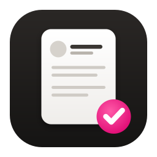
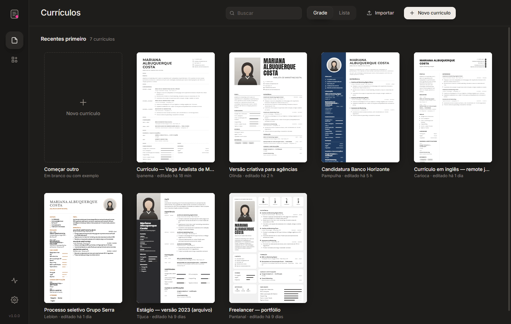
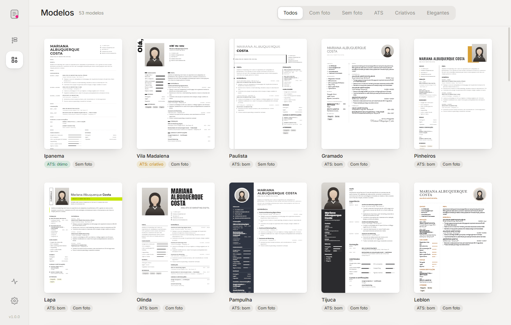
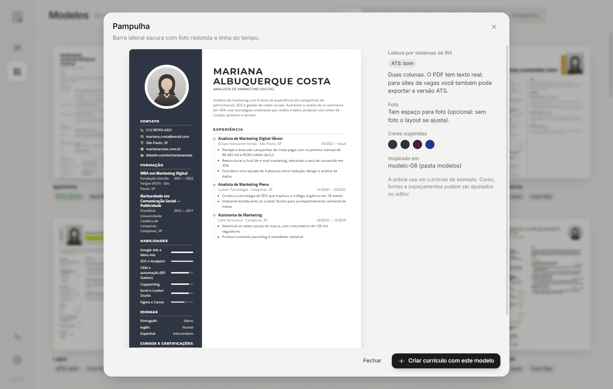
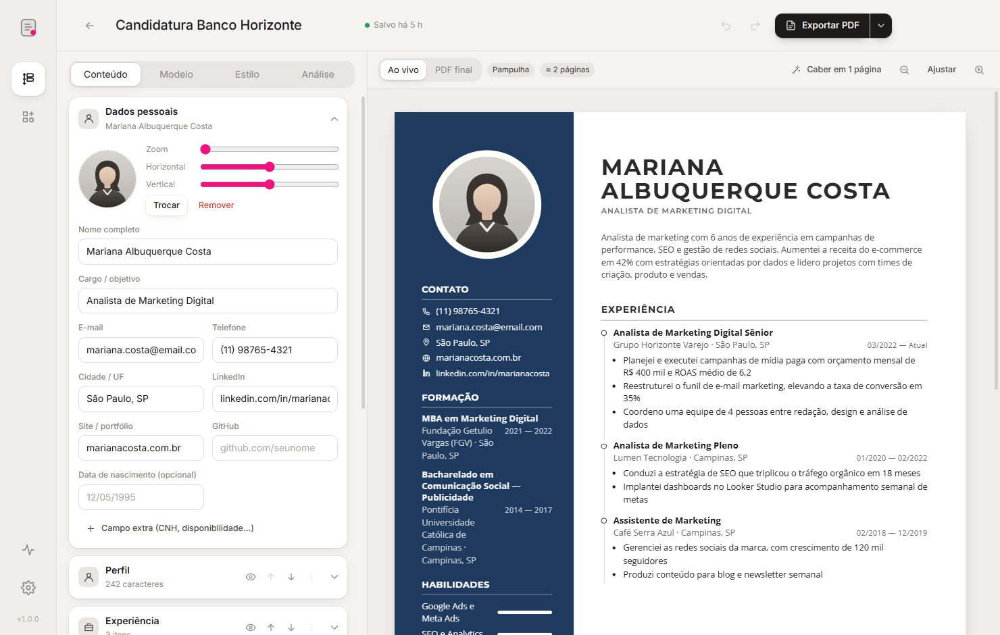
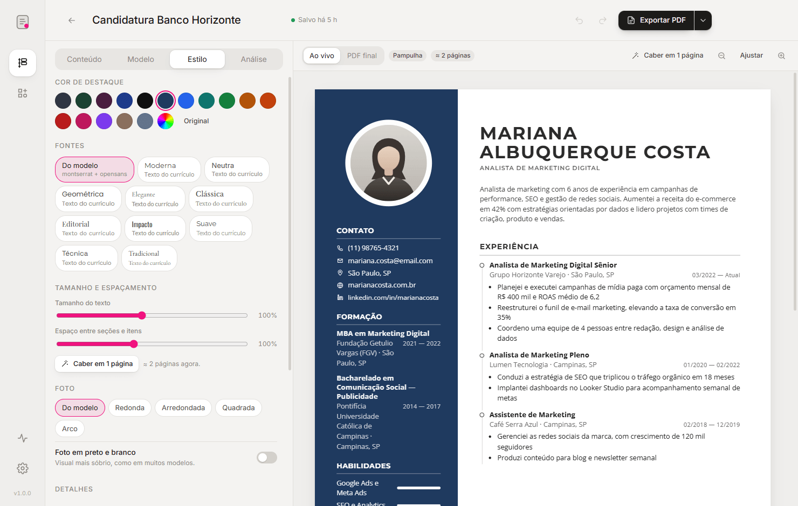
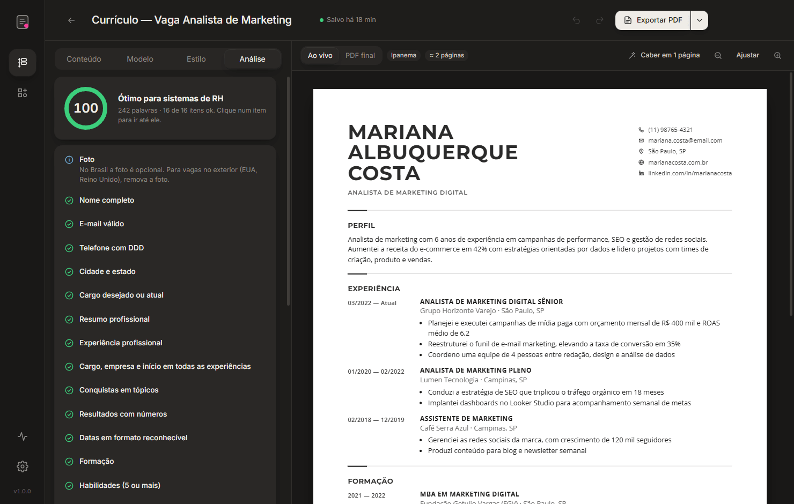
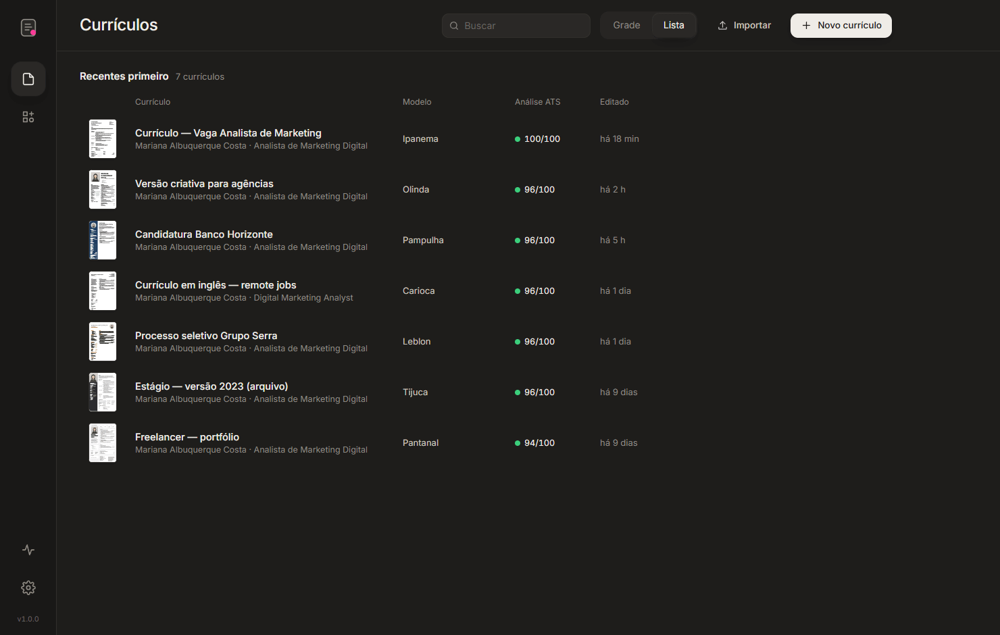
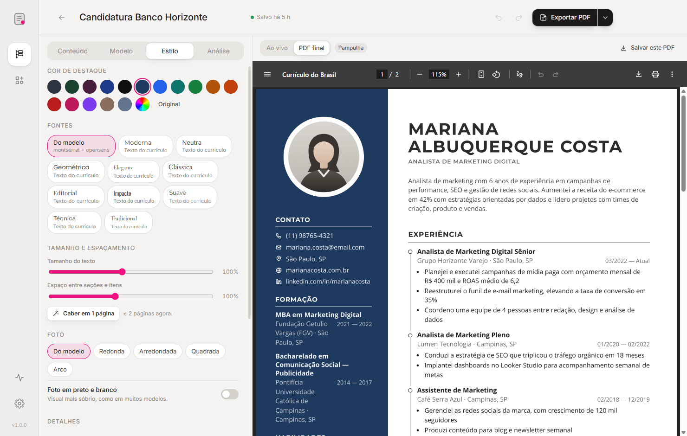
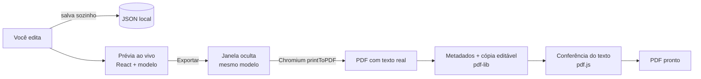

<div align="center">


# Currículo do Brasil
**Currículos bonitos, lidos por qualquer RH.**
*Crie e edite currículos com 53 modelos profissionais e exporte um PDF com texto de verdade — que sistemas de recrutamento (ATS) e IAs conseguem ler.*

[](https://github.com/luiscriativo/curriculodobrasil/releases/latest)
[](LICENSE)
[](https://www.electronjs.org/)
[](https://react.dev/)
[](#-instalação)

[**⬇ Baixar**](https://github.com/luiscriativo/curriculodobrasil/releases/latest) · [Todas as versões](https://github.com/luiscriativo/curriculodobrasil/releases)


</div>

---

## O que é o Currículo do Brasil?

Um aplicativo para Windows, macOS e Linux para montar currículos sem brigar com o Word. Você preenche seus dados uma vez, escolhe entre **53 modelos** (clássicos, elegantes, criativos e versões próprias para ATS) e vê o resultado mudando ao vivo enquanto digita. Trocar de modelo não perde nada.

O ponto mais importante está no arquivo final: o **PDF sai com texto de verdade** — selecionável, copiável e lido corretamente por sistemas de recrutamento (Gupy, Kenoby, Workday, LinkedIn…) e por IAs que fazem a triagem. O app ainda **confere o texto do PDF** depois de exportar, avisa se algo não for legível e guarda **dentro do próprio PDF** uma cópia editável do currículo: arraste o PDF de volta para o app e continue editando.

Tudo fica no seu computador e é salvo automaticamente.

## ✨ Recursos

**🎨 53 modelos, prontos para trocar a qualquer momento**
- Inspirados em modelos profissionais: colunas laterais escuras, serifados elegantes, nomes enormes em letras condensadas, cartões estilo "bento", linhas do tempo…
- Cada modelo indica o quanto é fácil de ler por sistemas de RH (ótimo, bom ou criativo).
- Cores, fontes (10 combinações + as do modelo), tamanho do texto, espaçamento, formato da foto (redonda, quadrada, arco) e foto em preto e branco.

| Galeria de modelos | Detalhe do modelo |
|---|---|
|  |  |

**✍️ Editor com prévia ao vivo**
- Dados pessoais, foto (com zoom e enquadramento), resumo, experiência, formação, habilidades, idiomas, cursos, projetos, prêmios, voluntariado, referências, interesses e seções personalizadas.
- Seções e itens reordenáveis, ocultáveis (sem apagar) e renomeáveis; posição em coluna principal ou lateral.
- Descrições com tópicos (é só começar a linha com “- ”), datas em qualquer formato (03/2021, mar 2021, 2021), corretor ortográfico em português.
- **Desfazer/refazer** em tudo, salvamento automático, estimativa de páginas com as quebras marcadas e o botão **“Caber em 1 página”**.
- Modo **PDF final**: mostra exatamente o arquivo que será exportado.

| Editor (tema claro) | Estilo |
|---|---|
|  |  |

**📄 PDF feito para robôs e para pessoas**
- Texto real com fontes embutidas, links de e-mail/LinkedIn clicáveis e PDF marcado (acessível).
- Título, autor, cargo e palavras-chave gravados nos metadados do PDF.
- Conferência automática: o app lê o PDF como um ATS faria e confirma nome, e-mail, telefone, cargo e experiência.
- **Versão ATS** em um clique (uma coluna, sem enfeites) — ou gerada junto automaticamente.
- Letras muito espaçadas (comuns em modelos elegantes) viram “A N A L I S T A” para os robôs; por padrão o app limita esse espaçamento. Dá para ligar o visual original em Estilo.

**🎯 Análise para ATS**
- Nota de 0 a 100 e checklist clicável: contato completo, resumo, conquistas em tópicos, resultados com números, datas, habilidades, modelo…
- **Compare com uma vaga**: cole o anúncio e veja quais palavras-chave da vaga já estão no currículo e quais faltam.



**🗂 Organização**
- Seus currículos em grade (miniaturas) ou lista (modelo, nota ATS e última edição), busca, duplicar, excluir com “Desfazer”.
- Importar/exportar `.json`, backup de todos os currículos, arrastar arquivos para a janela.
- Tema claro e escuro (automático), diagnóstico com teste real do motor de PDF.

| Lista | PDF final |
|---|---|
|  |  |

## ⚙️ Como funciona



1. Os currículos ficam em arquivos `.json` na pasta do app (um por currículo), gravados de forma segura a cada alteração.
2. A prévia e o PDF usam **o mesmo código de modelo**, então o que você vê é o que sai.
3. Para exportar, o app desenha o currículo numa janela invisível e imprime com o motor do Chrome: o texto continua sendo texto.
4. Depois grava os metadados, anexa a cópia editável e lê o PDF de volta para conferir o texto.

## 📦 Instalação

| Sistema | Arquivo |
|---|---|
| **Windows** (a maioria dos PCs) | `CurriculoDoBrasil-<versão>-win-x64-setup.exe` (instalador) ou `…-win-x64-portable.exe` |
| **Windows on ARM** | `CurriculoDoBrasil-<versão>-win-arm64-setup.exe` |
| **macOS** Apple Silicon (M1 ou mais novo) | `CurriculoDoBrasil-<versão>-mac-arm64.dmg` |
| **macOS** Intel | `CurriculoDoBrasil-<versão>-mac-x64.dmg` |
| **Linux** x64 / ARM | `.AppImage`, `.deb` ou `.rpm` |

Baixe em [Releases](https://github.com/luiscriativo/curriculodobrasil/releases/latest).

**Primeira execução**
- **Windows:** o SmartScreen pode avisar que o app não é reconhecido → **Mais informações → Executar assim mesmo**.
- **macOS:** o app não é notarizado → clique com o botão direito no app → **Abrir** → **Abrir**.
- **Linux (AppImage):** `chmod +x CurriculoDoBrasil-*.AppImage` e execute.

## 🔄 Atualizações

O app verifica novas versões ao abrir e a cada 6 horas.

| Instalação | O que acontece |
|---|---|
| Windows (instalador) e Linux AppImage | Aviso no app → **Baixar atualização** (com progresso) → **Reiniciar e instalar**. Se você só fechar o app, instala ao sair. |
| macOS | Aviso no app; o botão abre a página da versão para baixar o novo `.dmg`. |
| Windows portátil, Linux `.deb`/`.rpm` | Aviso no app; o botão abre a página da versão. |

Em **Configurações → Atualizações** dá para verificar na hora.

## 🔒 Seus dados

- Tudo fica no seu computador, na pasta de dados do app (Configurações → Seus dados → Abrir):
  - Windows: `%APPDATA%\Currículo do Brasil\curriculos`
  - macOS: `~/Library/Application Support/Currículo do Brasil/curriculos`
  - Linux: `~/.config/Currículo do Brasil/curriculos`
- Nada é enviado para a internet. A única conexão é a verificação de atualizações nas releases do GitHub.
- A cópia editável dentro do PDF pode ser desligada em **Configurações → Exportação**.

## ⌨️ Atalhos

| Atalho | Ação |
|---|---|
| `Ctrl+N` | Novo currículo |
| `Ctrl+O` | Importar (JSON ou PDF gerado pelo app) |
| `Ctrl+E` / `Ctrl+Shift+E` | Exportar PDF / versão ATS (no editor) |
| `Ctrl+P` | Ver o PDF final |
| `Ctrl+Z` / `Ctrl+Y` | Desfazer / refazer |
| `Ctrl+,` | Configurações |

No macOS, use `Cmd` no lugar de `Ctrl`.

## 🛠 Desenvolvimento

Requisitos: Node.js 22+.

```bash
git clone https://github.com/luiscriativo/curriculodobrasil.git
cd curriculodobrasil
npm install
npm start
```

| Script | O que faz |
|---|---|
| `npm start` | Compila a interface (Vite) e abre o app |
| `npm run check` | Tipos (TypeScript) e sintaxe de todo o JavaScript |
| `npm test` | Testes unitários (`node --test`) |
| `npm run dist:win` / `dist:mac` / `dist:linux` | Gera os instaladores localmente |
| `npm run icons` | Gera os ícones a partir do SVG |
| `npm run demo` | Cria dados de demonstração em `demo-data/profile` |

```
src/
  main/        processo principal (janela, armazenamento, PDF, atualização)
  shared/      lógica pura: modelo de dados, datas, análise ATS, exemplo (testada no Node)
  renderer/
    templates/ motor dos modelos (engine.tsx) e os 53 modelos (set-a…d.tsx)
    pages/     telas: início, modelos, editor, configurações, diagnóstico
    styles/    tema do app, base dos currículos e fontes embutidas
scripts/       ícones, fontes, dados de demonstração, prévia do link, build
test/          testes unitários
modelos/       imagens de referência dos modelos (só local, fora do git)
```

**Dados de demonstração** (para prints e testes, sem tocar nos seus currículos):

```bash
npm run demo
npx vite build && npx electron . --user-data=demo-data/profile
```

**Adicionando um modelo:** crie um objeto `TemplateDef` num dos arquivos `src/renderer/templates/set-*.tsx` — o CSS começa com `.T` (vira `.tpl-<id>`) e a função `render` combina as peças do `engine.tsx` (`Name`, `Contacts`, `Photo`, `Secs`…). Mantenha a ordem do HTML igual à ordem de leitura: é a ordem do texto no PDF. Para fontes novas, adicione o pacote `@fontsource` e rode `node scripts/build-fonts.mjs`.

## 🚀 Publicando uma versão

**Actions → Release → Run workflow** e escolha o tipo:

| Tipo | Exemplo | Quando usar |
|---|---|---|
| `patch` | 1.0.0 → 1.0.1 | Correções |
| `minor` | 1.0.0 → 1.1.0 | Novidades |
| `major` | 1.0.0 → 2.0.0 | Mudança grande |
| `teste` | — | Só gera os instaladores (artefatos do run), sem release |

O workflow checa o código, gera Windows (x64, ARM e portátil), macOS (Apple Silicon e Intel) e Linux (x64 e ARM: AppImage, .deb, .rpm), grava a versão no `package.json`, cria a tag e publica a release com a tabela de downloads. Os apps instalados passam a ver a atualização. Os arquivos seguem o padrão `CurriculoDoBrasil-<versão>-<sistema>-<arquitetura>`.

Também dá para enviar uma tag (`git tag v1.0.0 && git push origin v1.0.0`) — a release fica como rascunho para revisar.

## ❓ Solução de problemas

| Problema | Solução |
|---|---|
| “O arquivo está aberto em outro programa” ao exportar | Feche o PDF no leitor (Acrobat, navegador) e exporte de novo, ou salve com outro nome. |
| O PDF ficou com 2 páginas | Use **Caber em 1 página**, reduza descrições ou oculte seções menos importantes. |
| O sistema da vaga leu errado | Exporte a **versão ATS** (uma coluna) e confira em **Análise**. |
| Importar um PDF diz que não há dados editáveis | Só PDFs gerados pelo app com “Dados editáveis no PDF” ligado podem ser reabertos. |
| Algo estranho no app | Abra **Diagnóstico** e use **Testar agora** no motor de PDF. |

## Licença

[MIT](LICENSE) © luiscriativo
